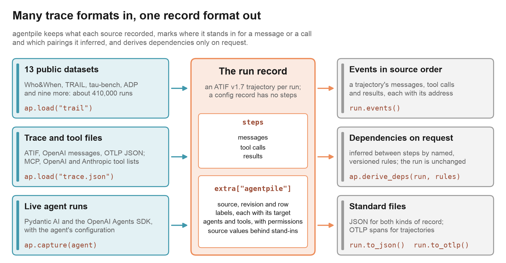

<div align="center">

# agentpile

**Public agent-trajectory datasets and agent traces, loaded into one record format.**

[](https://github.com/yzhao062/agentpile/actions/workflows/tests.yml)
[](https://pypi.org/project/agentpile/)
[](https://github.com/yzhao062/agentpile/blob/main/pyproject.toml)
[](https://github.com/yzhao062/agentpile/blob/main/LICENSE)

[Quick Start](#quick-start) · [Datasets](#datasets) · [The Record](#the-record) · [Capturing a Running Agent](#capturing-a-running-agent) · [Extending](#extending)

</div>

<p align="center">
  
</p>

Researchers who audit or evaluate LLM agents draw on a dozen public trajectory datasets, and each stores a run in its own schema (e.g., chat messages in tau-bench, OpenTelemetry spans in TRAIL, raw log text in MAST). agentpile reads every one of them, along with trace files and live runs of two agent frameworks, into the same run record: an [ATIF v1.7](https://github.com/harbor-framework/harbor) trajectory with a small extension. It keeps the source's own labels, call pairings and configuration, marks where it had to stand in for a message or a call, and never fills in what the source did not record.

agentpile is a loader, not a dataset. It downloads each dataset from its original publisher at a pinned revision and redistributes nothing. The name follows the habit of calling a mixed collection a pile. The library has no connection to EleutherAI's The Pile.

## What You Get

- **13 datasets by name.** About 410,000 runs, each dataset at a pinned revision and checked against the run count in its manifest.
- **Trace and tool files.** ATIF, OpenAI-style messages, OTLP JSON (OpenInference and OTel GenAI attributes), and MCP, OpenAI and Anthropic tool lists, with the format detected.
- **Live capture.** A run of a Pydantic AI or OpenAI Agents SDK agent, with the agent's configuration attached.
- **Labels with targets.** Each label a reader emits points at the run, agent, step, call, span or tool it describes.
- **Inference kept apart.** Loading infers no dependencies. `ap.derive_deps` infers them on request, and each names the rule and version that produced it.
- **Standard files out.** A trajectory writes ATIF JSON, checked against Harbor's models, or OTLP spans for telemetry tools, and a config record writes JSON.
- **A core with no dependencies.** Python 3.9 to 3.13 and the standard library, with extras for Hugging Face downloads and capture.

## Quick Start

```bash
pip install agentpile          # the core: standard library only
pip install "agentpile[hf]"    # adds downloads of the Hugging Face datasets
```

A conversation in the OpenAI chat format needs only the core:

```python
import agentpile as ap

messages = [
    {"role": "user", "content": "Is it raining in Paris?"},
    {"role": "assistant", "content": None, "tool_calls": [{"id": "call_1", "type": "function",
        "function": {"name": "get_weather", "arguments": "{\"city\": \"Paris\"}"}}]},
    {"role": "tool", "tool_call_id": "call_1", "content": "light rain, 14 C"},
    {"role": "assistant", "content": "Yes, light rain."},
]
run = next(ap.load(messages))             # the format is detected, and an ambiguous input is an error
for event in run.events():                # messages, tool calls and tool results in source order
    print(event.kind, event.role, event.content)

for dep in ap.derive_deps(run, rules=["tool_call_id"]):   # inferred only when you ask, by a named rule
    print(dep["rule"], "step", dep["src"]["step"], dep["src"]["call"], "-> step", dep["dst"]["step"])

run.to_json("run.json")                   # ATIF v1.7 JSON; run.to_otlp("run.otlp.json") writes OTLP spans
```

```text
message user Is it raining in Paris?
message agent None
call agent {'city': 'Paris'}
result tool light rain, 14 C
message agent Yes, light rain.
tool_call_id step 2 call_1 -> step 3
```

The second line is a stand-in made visible. ATIF does not permit the `null` in the source's first assistant message. agentpile therefore stores an empty string in the record and notes that the source held `null`, and the event reports `None`. Rule `tool_call_id` gives the dependency: it makes the next agent step after a result depend on the call that produced it, here the final answer (step 3) on `call_1` in step 2.

A dataset loads by name at its pinned revision (`ap.datasets.names()` lists them), and a trace file by its path (`ap.readers.names()` lists the formats):

```python
for run in ap.load("who_and_when", limit=5):   # downloads once, into the cache described below
    print(run.id, run.labels)                  # the labels the reader emits, each with its target
run = next(ap.load("my_trace.json"))           # ATIF, OpenAI messages, OTLP JSON or a tool list
```

## Datasets

Each name loads one dataset at the revision shown, and a full load is checked against the run count in its [manifest](https://github.com/yzhao062/agentpile/tree/main/src/agentpile/corpora/manifests). Harbor's ATIF v1.7 models (Harbor 0.22.0) accept every trajectory checked: the first 3,000 runs of each dataset, or all of a smaller one. `tools/dataset_table.py` regenerates this table.

| Name | Source at pinned revision | Runs | Source annotation levels | License on the card |
|---|---|---|---|---|
| `who_and_when` | [Kevin355/Who_and_When](https://huggingface.co/datasets/Kevin355/Who_and_When) @ `59b9fcb` | 184 | run, step | not declared |
| `mast` | [mcemri/MAST-Data](https://huggingface.co/datasets/mcemri/MAST-Data) @ `95118ac` | 1,642 | run | cc-by-4.0 |
| `trail` | [PatronusAI/TRAIL](https://huggingface.co/datasets/PatronusAI/TRAIL) @ `b424ce6` | 148 | run, span | mit |
| `tau_bench` | [AgentSuite/tau-bench-trajectories](https://huggingface.co/datasets/AgentSuite/tau-bench-trajectories) @ `382e57d` | 4,950 | run | not declared |
| `tau2_bench` | [AgentSuite/tau2-bench-trajectories](https://huggingface.co/datasets/AgentSuite/tau2-bench-trajectories) @ `07264f1` | 8,340 | run | not declared |
| `agent_reward_bench` | [McGill-NLP/agent-reward-bench](https://huggingface.co/datasets/McGill-NLP/agent-reward-bench) @ `b6d17e6` | 1,302 | run | not declared |
| `agentdojo` | [sungjuncho/agentdojo-trajectories](https://huggingface.co/datasets/sungjuncho/agentdojo-trajectories) @ `43df1b8` | 15,095 | call, run, span | not declared |
| `swe_rebench_openhands` | [nebius/SWE-rebench-openhands-trajectories](https://huggingface.co/datasets/nebius/SWE-rebench-openhands-trajectories) @ `3545538` | 67,074 | run | cc-by-4.0 |
| `swe_agent_nebius` | [nebius/SWE-agent-trajectories](https://huggingface.co/datasets/nebius/SWE-agent-trajectories) @ `68195a1` | 80,036 | run, step | cc-by-4.0 |
| `swe_gym_openhands` | [SWE-Gym/OpenHands-Sampled-Trajectories](https://huggingface.co/datasets/SWE-Gym/OpenHands-Sampled-Trajectories) @ `baf3a4e` | 6,055 | run | not declared |
| `swe_smith` | [SWE-bench/SWE-smith-trajectories](https://huggingface.co/datasets/SWE-bench/SWE-smith-trajectories) @ `08e109b` | 24,100 | run, step | mit |
| `adp` | [neulab/agent-data-collection](https://huggingface.co/datasets/neulab/agent-data-collection) @ `31a76bf` | 200,914 | run | not declared |
| `catchbench_pre` | [yzhao062/catchbench](https://github.com/yzhao062/catchbench) @ `30a516c` | 1,187 | run, tool | MIT; rows name their upstream license |

The annotation column lists the levels at which each source annotates its runs, as its manifest records them. Readers turn part of these annotations into `run.labels`: run labels for every dataset except ADP, plus step and agent labels for Who&When, span labels for TRAIL and tool labels for CatchBench PRE. The rest stay elsewhere in the record (e.g., ADP's results in `run.outcome`, SWE-smith's patch in `run.dataset`).

> [!WARNING]
> TRAIL's harness logs contain GAIA reference answers and SWE-bench gold patches. agentpile keeps them as recorded. Remove them before you show a TRAIL run to an agent under test, using the `gold_note` of the TRAIL manifest, which names each field.

- **TRAIL** is gated on Hugging Face: accept its terms on the dataset page with the account whose token you use.
- **AgentRewardBench** run files total about 30 GB, because each step keeps the browser state the agent saw.
- **SWE-smith** loads its `tool` split. 14,984 of its 24,100 rows write actions as text and load as plain messages, and `message_format="native"` returns only the 9,116 rows with structured calls.
- **ADP** loads the 14 configurations whose records pass validation and a count check, and the manifest lists the rest. The loader follows ADP's own ADP-to-ATIF converter with two changes, both to keep the source's roles. An environment observation that answers no call becomes a user step whose `role` is `environment`, where ADP's converter makes it an empty agent step. A call's result keeps the observation's own `source`, where ADP's converter relabels `user` as `environment`.

## The Record

A trajectory record is an ATIF v1.7 trajectory, the Agent Trajectory Interchange Format of the Harbor evaluation framework. What ATIF has no field for sits under `extra["agentpile"]`: where the run came from, the source's labels with their targets, the agents and tools with their permissions, and the source value behind each message or call stand-in. A configuration with no execution (e.g., an MCP tool list) is a config record (`agentpile-config/0`) with the same agents, tools and labels at its top level and no steps.

Loading never adds what the source did not record: it keeps any dependencies the input states and infers none. The few pairings a reader has to infer carry `paired_by` with the name of the rule, and `ap.derive_deps(run, rules=[...])` infers dependencies between steps when you ask.

<details>
<summary>What the extension holds, and how inference and export work</summary>

<br>

- **Source and identity:** dataset, revision, file, record key and reader version, enough to trace every run back to the row it came from.
- **Labels with targets:** each label points at the run, an agent, a step, a call, a span or a tool, with the label's origin (expert, LLM judge, benchmark).
- **Agents and tools:** each agent's instructions, model and tools, and each tool's original definition, its permission, and where that permission came from.
- **Stand-ins made visible:** where ATIF requires a value the source did not have (a non-null message, an object of arguments, a call id, an image part it cannot hold), the record keeps the source value and the event view reports it. A missing value, a null and an empty string therefore stay distinct. A call whose source arguments were neither a JSON object nor null keeps them in `arguments_raw` and carries `arguments_state: "unparsed"`, and in `run.to_otlp()` its model span and its tool span both show that source value. For any other call the model span shows the parsed arguments, and the tool span shows the source text where the reader kept it.
- **Source order:** `run.events()` follows the order the source recorded, which differs from ATIF where ATIF stores a result on the step that issued the call (a delegated agent's steps can come in between). A reader whose references are not integers (e.g., TRAIL's span addresses) stores an integer sort position beside each reference (`source_pos`, `result_pos`), and the reference itself keeps pointing back into the source.

CatchBench PRE rows load as config records, and so do tool definitions: an MCP `tools/list` result, an OpenAI tool list and an Anthropic tool list (readers `mcp-tools-list`, `openai-tools` and `anthropic-tools`), each definition kept verbatim. An MCP tool's permission comes from its annotations when it states them and is `unknown` otherwise.

Inferred pairings include a result matched to its call by position, a TRAIL history call placed on the latest agent step, and a TRAIL TOOL span tied to its call by a unique match. Every dependency from `ap.derive_deps` names the rule and version that produced it, and `run.with_deps(rules=[...])` returns a copy whose steps carry those entries, which `to_otlp()` then writes as span links. The run you loaded is not changed.

`run.to_otlp()` writes a run as OTLP JSON spans in the layout of Harbor's ATIF-to-OpenTelemetry converter. A run loaded from a trace writes each of its source spans once, and a telemetry tool therefore counts the same model and tool operations as in the original trace. The spans agentpile adds around them (the trajectory, user and system steps) are CHAIN spans, not model or tool operations. Reading an OTLP trace whose instrumentation version differs from the tested ones raises an error unless you pass `allow_untested_version=True`, which marks the record as read from an untested version.

</details>

## Capturing a Running Agent

`ap.capture` records a run of a Pydantic AI agent or an OpenAI Agents SDK agent into the same record, with the agent's configuration attached:

```bash
pip install "agentpile[pydantic-ai]"     # or "agentpile[openai-agents]"
```

```python
with ap.capture(agent=my_agent) as cap:
    my_agent.run_sync("Book a flight from LAX to SFO.")
cap.run            # the captured run
cap.otlp           # the same spans as an OTLP JSON document
ap.config_from(my_agent)   # the configuration alone: instructions, model, tools with schemas, handoffs
```

Capture is tested with Pydantic AI 2.58.0 and 2.59.0 and with the OpenAI Agents SDK 0.24.0 through openinference-instrumentation-openai-agents 2.5.3. agentpile checks the version of the instrumentation that wrote the spans, which is Pydantic AI itself or, for the Agents SDK, OpenInference. With any other instrumentation version `cap.run` raises an error, and `ap.capture(my_agent, allow_untested_version=True)` builds the run anyway and marks it `source.dialect_tested` false.

<details>
<summary>Which runs a capture records</summary>

<br>

A capture uses its own tracer provider and never sets the global one. Observers the host program already had keep receiving every span, and the agent's original instrumentation setting is restored when the block exits, including on an exception. Everything a capture records happens while the block is open and only for the agents passed to `capture()`. Runs of other agents in the same window are not recorded. What counts as a selected agent's run depends on the framework. For the Agents SDK, a trace in which a selected agent takes part (it starts the run, receives a handoff, or is called as a tool) is recorded whole, other participants included. Because the SDK names agents only by name in its spans, an unselected agent that shares a selected agent's name is also recorded. For Pydantic AI, each selected agent's own runs are recorded: an agent that a selected agent calls from a tool is recorded only when it is selected too. Pass every agent whose delegated work you want.

</details>

## Extending

A reader is any object with `sniff(source) -> bool` and `read(source) -> Iterator[Run]`. Register one for a session with `ap.register("my-format", reader)`, or ship it in a package through the entry-point group `agentpile.readers` (datasets and writers have `agentpile.datasets` and `agentpile.writers`). Pass `reader="..."` to `ap.load` to skip detection.

## Downloads and Cache

Downloaded files live in one place, `~/.cache/agentpile/<dataset>/<revision>/` (set `AGENTPILE_CACHE` to move it), and never in the shared Hugging Face cache. `ap.cache_info()` lists what is there and `ap.clear_cache()` removes it.

## Status

Alpha. Version 0.1.0 covers the 13 datasets above, each checked against a manifest of pinned counts, the ATIF, OpenAI-style message, OTLP JSON, tool-definition and agentpile config formats, and capture for Pydantic AI and the OpenAI Agents SDK. The record format may still change before 1.0, and the [changelog](https://github.com/yzhao062/agentpile/blob/main/CHANGELOG.md) lists every change.

## License

Apache-2.0 for the code. Each dataset keeps its publisher's terms. Several declare no license on their dataset card, and agentpile records what each card says in its manifest. The tests use synthetic fixtures in each dataset's file layout and copy no dataset content.

<p align="right"><a href="#agentpile">back to top</a></p>
